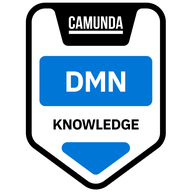

<a href="https://goulartelb.github.io/link-Bio/">
  
</a>

<p align="center">
  <a href="https://www.linkedin.com/in/lucas-goularte-desenv/"></a>
  <a href="mailto:goulartelucasbeluco@gmail.com"></a>
  <a href="https://goulartelb.github.io/link-Bio/"></a>
  <a href="https://www.instagram.com/goularte3080/"></a>
  <a href="https://app.daily.dev/lucasgoularte"></a>
</p>

<br />

<picture>
  <source media="(prefers-color-scheme: dark)" srcset="images/title-about-dark.svg" />
  
</picture>

Software engineer with **3+ years** in the industry, building **Java** and **C#/.NET** backends shaped by **Domain-Driven Design** and proven by **tests**.
On the front end I ship interfaces with **React**, **Vue.js** and **Flutter**. As a freelancer I take products end to end: modeling the domain, designing the architecture, writing the code and running it in production.

```csharp
public sealed record Developer
{
    public string   Name       => "Lucas Goularte";
    public string   Role       => "Software Engineer · backend-first";
    public string   Degree     => "Systems Analysis & Development · SENAC Tubarão";
    public string   Studying   => "Postgrad in Software Engineering & Architecture";
    public string[] Core       => ["Java", "C#", ".NET", "Spring Boot"];
    public string[] Craft      => ["DDD", "TDD", "Hexagonal", "SOLID"];
    public bool     OpenToWork => true; // 👋 say hi
}
```

<picture>
  <source media="(prefers-color-scheme: dark)" srcset="images/title-now-dark.svg" />
  
</picture>



<picture>
  <source media="(prefers-color-scheme: dark)" srcset="images/title-work-dark.svg" />
  
</picture>

<p align="center">
  
  
  
  <a href="https://github.com/GoularteLB/ControleVacina"></a>
</p>

<picture>
  <source media="(prefers-color-scheme: dark)" srcset="images/title-oss-dark.svg" />
  
</picture>

<a href="https://github.com/GoularteLB/Blueprint"></a>
<a href="https://github.com/GoularteLB/hexagonal-architecture-with-kotlin"></a>
<a href="https://github.com/GoularteLB/HotelBooking"></a>

<picture>
  <source media="(prefers-color-scheme: dark)" srcset="images/title-stack-dark.svg" />
  
</picture>

<p align="center">
  
</p>

<p align="center">
  
</p>

<details>
<summary><b>Full breakdown</b></summary>
<br />

| Category | Skills |
|---|---|
| **Languages** | Java (Spring Boot), C# (ASP.NET), Kotlin, Dart (Flutter) |
| **Front end** | React, Vue.js |
| **Testing** | JUnit, xUnit / NUnit, React Testing Library + Jest, Vue Test Utils + Jest |
| **Data & messaging** | PostgreSQL, MySQL, MongoDB, SQLite, Hive, Kafka |
| **Tooling** | Git, GitHub, GitLab, Docker, AWS |
| **Architecture** | DDD, Hexagonal (Ports & Adapters), MVVM, SOLID |
| **Process** | Camunda 8 (BPMN, DMN), Scrum, Kanban, Scrumban |

</details>

<picture>
  <source media="(prefers-color-scheme: dark)" srcset="images/title-certs-dark.svg" />
  
</picture>

<table align="center">
  <tr>
    <td align="center" width="220">
      <a href="https://academy.camunda.com/path/c8-lp-developer"></a>
      <br /><sub><b>Camunda 8 · BPMN 2.0</b></sub>
    </td>
    <td align="center" width="220">
      <a href="https://academy.camunda.com/path/dmn-lp"></a>
      <br /><sub><b>Camunda 8 · DMN</b></sub>
    </td>
  </tr>
</table>

<picture>
  <source media="(prefers-color-scheme: dark)" srcset="images/title-activity-dark.svg" />
  
</picture>

<picture>
  <source media="(prefers-color-scheme: dark)" srcset="https://raw.githubusercontent.com/GoularteLB/GoularteLB/output/snake-dark.svg" />
  
</picture>

<p align="center">
  
  
</p>

<p align="center">
  <a href="https://app.daily.dev/lucasgoularte"></a>
</p>

<a href="mailto:goulartelucasbeluco@gmail.com"></a>
